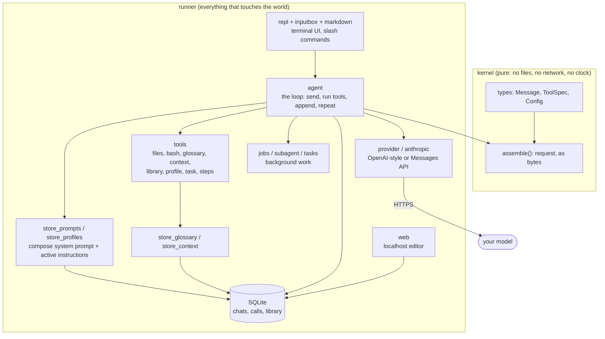

# Another Harness

**You Only Prompt Once.** A modular prompt system for building your own coding agent, in a
terminal, in about 70,000 lines of Rust (a good part of it tests) and five dependencies.

Most agent harnesses are a prompt you cannot see, wrapped around a loop you cannot change. This one
is the other way round. The agent is **assembled from parts you own**: system prompts, skills,
personalities and profiles that live in a database, a glossary and a set of rules the model can read
on demand, and a request builder that turns all of it into the same bytes every time you ask for the
same thing.

Write a prompt once. Switch it on for a chat, for one message, or bake it into a profile. Hand a
profile to a subagent. Ask the model to improve it. Edit it in a browser. Nothing is hidden in the
binary except one default prompt, and that one is a row in the database like the rest.

> **Status: early, and one person's tool.** It is used daily by its author against OpenRouter and
> the Anthropic Messages API, and has a large test suite (1,000+ tests, none touch the network), but
> few other people have run it. Expect rough edges, and read the [limits](#limits) before you point
> it at anything you care about.

---

## The idea: an agent is a few small, named parts

| Part | What it is | When it applies |
|---|---|---|
| **System prompt** | Plain text. Several can exist; the ones in your profile are joined, in order. | Fixed when a chat starts. |
| **Skill** | A named block of instructions ("review like a maintainer", "write tests first"). | `on` for the chat, or `once` for the next message only. |
| **Personality** | Like a skill, but exactly one at a time ("terse", "teacher"). | Every message while selected. |
| **Profile** | A named starting setup: which system prompts, which skills are on, which personality. | Chosen for new chats; a subagent can run under one. |
| **Glossary** | Words and definitions you keep ("the ledger", "a settled order"). | The model looks a word up instead of guessing. |
| **Context** | Rules, decisions, shapes and guides you have said about the project. | The model fetches one by name before work it may cover. |

All of it is stored, named and ordered in SQLite. You manage it from the chat, from the keyboard
(menus, or plain typed commands when there is no terminal) or from a local web page.

```text
/prompts add reviewer ./prompts/reviewer.md     save a prompt from a file
/skills on tests-first                          keep a skill on for this chat
/skills use reviewer                            ...or only for the next message
/personality terse                              one personality at a time
/profile use backend                            what new chats start with
/subagent reviewer check the diff in src/db     a background agent under another profile
/web                                            edit all of it in a browser
```

The model can manage the library too. The `library` and `profile` tools list, show, add, edit and
delete skills, personalities, prompts and profiles. Every change asks you first, shows the edit, and
a new item is saved **switched off** so it cannot silently change the next chat. After a refusal the
model is told not to ask again.

## Why the prompt is built the way it is

The goal is **determinism**, not saving tokens: the same state in gives the same request bytes out,
so behaviour is something you can diff and a provider's prompt cache can actually hit. Everything
below follows from that.

```text
┌─ system prompt ──────────────── frozen when the chat starts (profile's prompts, joined)
├─ tool definitions ───────────── fixed order, verbatim schemas
├─ message 1 … message N ──────── append-only; never rewritten, reordered or summarised in place
├─ "Active instructions" ──────── one message, added only when your skills/personality CHANGE
└─ "for this message only" ────── one-shot skills, appended last on each call, never saved
```

- **The system prompt never moves.** Turning a skill on or off does not edit it. It adds one
  clearly marked "active instructions" message to the end of the history, and only when the set
  actually changed. Everything before it stays byte-identical, so the cache keeps hitting.
- **One-shot skills cost nothing to forget.** A `once` skill rides at the very end of the request
  and is not saved, so the next request's prefix is exactly the previous one.
- **Old file text is trimmed on a schedule, not continuously.** After a while a request does not
  need the full text of a file the model wrote; the file is on disk. The trim is a pure function of
  the history (the last 6 user messages stay whole) and its cutoff moves only every 4 messages, so
  the cache is refilled rarely and a resumed chat gets the same view as a live one.
- **The request builder is pure.** `kernel::assemble()` takes a config and messages and returns a
  string. Struct fields serialise in declaration order, lists keep their order, and there is no map
  anywhere, so key order cannot leak into the bytes. A golden test pins the output.
- **The toolchain is pinned too.** Exact dependency versions, a pinned compiler, and SQLite compiled
  from bundled source, so every machine runs the same SQLite.

## Architecture

Two crates, one direction of dependency. The kernel knows nothing about the outside world; the
runner is everything that touches it.



| Where | What lives there |
|---|---|
| `kernel/` | The neutral message and tool types, and `assemble()`. Two dependencies. Written to be read: it carries running "Rust note" comments for people new to the language. |
| `runner/src/agent.rs` | The loop. For each thing you type it sends the whole history, runs the tools the model asks for, appends results, and sends again until the model answers in text or hits the cap of 20 calls per message. |
| `runner/src/tools/` | The model's hands. Path-confined file tools, `bash`, and the tools below. |
| `runner/src/store*.rs` | Persistence and the library. Versioned migrations (`PRAGMA user_version`), a backup written before each one, and your edited prompts are never overwritten by an upgrade. |
| `runner/src/provider.rs`, `anthropic.rs` | One chat-completions style (OpenRouter and compatible routers) and the Anthropic Messages API, with prompt-cache markers where the provider wants them. |
| `runner/src/jobs.rs`, `subagent.rs`, `tools/tasks.rs` | Background subagents and background shell commands. |
| `runner/src/repl.rs`, `inputbox.rs`, `markdown.rs`, `lineedit.rs` | The terminal: the `>` prompt under a rule, live status, menus, and Markdown rendering (headings, code, tables, lists, links). |
| `runner/src/web*.rs` | A small localhost-only server for editing the library in a browser, and for reviewing the inbox. |
| `runner/src/mcp.rs`, `mcp_serve*`, `store_buffer*` | The MCP client (this chat uses other servers' tools) and the MCP server (other harnesses use this store): read-only, buffer and direct modes, and the inbox table. |
| `runner/src/decider*.rs`, `jev.rs` | The optional models that suggest an answer for an inbox entry, and the labelled cases that measure them. |

## What the agent can do

**Tools.** Around fifteen, all listed with `/tools`:

- **Files:** `read_file`, `create_file`, `write_file`, `edit_file`, `delete_file`. Paths are
  confined to the working folder; absolute paths, `..` and links that lead out are refused.
- **Shell:** `bash`, with a 30 second limit. Looking commands (`ls`, `grep`, `find`, `git log`,
  `diff`, and pipes between them) run without asking. Anything else asks. `background: true` runs a
  long command in its own process group with a 64 KB output tail. `task` lists, reads and stops
  those commands and the model's own subagents (ids `s1`, `a1`).
- **Memory:** `glossary` and `context` read what you saved. `glossary_propose` and
  `context_propose` suggest an entry, with your own words as the quote, and you confirm each one.
- **Self-management:** `library` and `profile`, as above.
- **Planning:** `steps` is a checklist the model keeps for work with three or more stages. While it
  exists, the terminal shows the checklist instead of every call.
- **Delegation:** `delegate(task, profile)` hands a task to a subagent.

**Approvals.** `manual` asks before every file change; `auto` lets the file tools run, while `bash`
still asks for anything that is not a plain look. Answer "always" once and that exact kind of action
(say, `git` commands) stops asking for the rest of the run; `/approve forget` clears it.

**Plan mode.** `/plan` makes the harness refuse every change, not just ask the model to behave. The
model can only look, and must answer with a plan. Then you pick: build it here, build it with a
subagent, or keep discussing.

**Subagents.** `/subagent [profile] <task>`, or the model's `delegate`, starts an agent in a chat of
its own, under a profile of your choosing, on a background thread. It gets only the tools that look,
cannot ask you anything, and returns only a short final answer that is added to your chat at your
next message. Up to three at a time. `/tasks` shows subagents and background commands together, under
the prompt.

**Stopping a model that is stuck.** A call is bad if it failed or repeats the one before it exactly.
Three bad calls in a row add a note telling the model to stop and ask you; five end the message.

**Context that grows without being pasted.** `/init` has the model read your project and propose
glossary words and context entries for you to accept one at a time. Context entries marked as
preloaded start every subagent with them.

## Other harnesses can use it as a store (MCP)

The same database can be served to another harness (Claude Code, opencode, anything that speaks MCP
over standard input and output), so your prompts, glossary and context are not locked inside this
chat. `--mcp-serve` starts no chat and needs no provider; the folder it starts in is the project.

| Command | What the other harness can do |
|---|---|
| `--mcp-serve` | **Buffer mode (the default).** Read the library, glossary, context and profiles, and `submit` a proposed entry. Nothing changes until you accept it. |
| `--mcp-serve --read-only` | Read only. |
| `--mcp-serve --direct` | Read, and write straight into the store (no review; back the database up first). |

In buffer mode a `submit` lands in an **inbox**. You open it on the web page (`/inbox`) or in the chat
(`/inbox`, `/inbox show N`, `/inbox accept N`, `/inbox reject N [note]`), see it next to what is stored
now, and accept or reject it. Applying is plain code with no model in it; rows are kept, so the inbox
is also the record of who proposed what. What the sender calls itself is a claim, not an identity, and
text with control or invisible characters is refused.

A **decider** can suggest an answer for each entry, never decide it:

```bash
claude mcp add aharness -- /path/to/src/target/debug/runner --mcp-serve --decider llm:openrouter
```

**Detached (issue 52).** Over standard input and output a server lives and dies with the harness that
started it, and keeps the binary it started with. `--mcp-serve -d` (`--detach`) instead starts it in
the background as an HTTP server on `127.0.0.1:8788` (`--port N` changes it) and returns; it takes
the same `--read-only`, `--direct` and `--decider` and serves the folder it was started in.
`--http` runs the same server in the foreground. Stop it with `--mcp-stop [--port N]`; after a
rebuild stop it and start it again, and the harness registration stays valid.

```bash
./chat.sh --mcp-serve -d
claude mcp add --transport http aharness http://127.0.0.1:8788/mcp \
  --header "Authorization: Bearer $(cat ~/.local/share/aharness/mcp-token)"
./chat.sh --mcp-stop
```

Every request must carry the token in `mcp-token` (made on first use, readable by you only, kept
across restarts; delete the file for a new one); a wrong `Host`, or any `Origin` header (a web page),
is refused. The pid and settings are in `mcp-serve-PORT.json` and what it printed in
`mcp-serve-PORT.log`, both in the data folder. One request is answered at a time; there is no
streaming or session. Unix only.


`--decider` is `none` (the default), `llm[:PROVIDER[:MODEL]]` (any saved provider) or
`jev[:PROVIDER[:MODEL]]` (OpenRouter's Jev decision model). The suggestion is stored once and shown
next to the entry; it is never shown to the sender and never applied. A decider sends the entry's text
to its provider and costs tokens, which is why it is off unless you ask. `--eval-decider SPEC` runs 18
labelled cases through a decider and prints how it did, so a model is measured before it is trusted.
Jev's API is an alpha; see `context/index/decisions/` (11 to 15) for the reasons behind each choice.

`--auto-accept` (with `--decider`) lets a confident Accept apply a **new** entry at once; a replacement,
a delete, a reject, an unsure or a weak accept still waits for you. The row says it was accepted
automatically. It is off unless you pass it (decision 14, amendment).

The other direction works too: `/mcp add NAME COMMAND` lets this chat use another MCP server's tools,
each tool set to ask, run free or be off.

## Everything is recorded

- **SQLite is the record.** Every message verbatim, and for every model call: the SHA-256 and size
  of the request, the raw response, token counts including cache reads and writes, which provider
  actually served it, timing and errors. API keys are never stored with a chat.
- **A JSONL turn log** sits next to it, one line per call, holding the full request exactly as sent.
  "What did the model actually see?" is always answerable.
- **Resume anything.** `/resume`, `/sessions`, or `--resume` for the latest. `/compact` has the
  model summarise a chat and continue in a new one, and does it for you before a message once the
  last request passed 80,000 prompt tokens. The old chat stays saved.
- **Provider and model are runtime choices.** `/provider`, `/model` and `/models` switch with the
  next message, and the model you pick is the one the next start uses. Providers are saved in the
  database; their keys are asked for once.

## Install

**Linux x86_64 (no Rust or C compiler needed).** Download a package from the
[Releases page](https://github.com/EldwinPr/Another-Harness/releases):

```bash
sudo apt install ./aharness_0.1.0-1_amd64.deb     # Debian, Ubuntu
sudo dnf install ./aharness-0.1.0-1.x86_64.rpm    # Fedora, RHEL
tar xzf aharness-v0.1.0-linux-x86_64.tar.gz       # or just unpack and run ./aharness
```

Then run `aharness` in any folder (`aharness --serve` opens the local web page; `aharness --mcp-serve` is the MCP server). Check the download against `SHA256SUMS`. Windows is not
supported yet and macOS is untested; build from source there.

## Quick start (from source)

You need a Rust toolchain (the version is pinned in `rust-toolchain.toml`, so `rustup` picks it up)
and a C compiler, because SQLite is built from bundled source.

```bash
git clone https://github.com/EldwinPr/Another-Harness.git
cd Another-Harness/src
./chat.sh
```

`chat.sh` runs the chat in `workspace/`. To work in a real repository instead, run `harness.sh`
from inside it (or link it onto your `PATH`):

```bash
cd ~/code/some-repo && /path/to/Another-Harness/src/harness.sh
```

Then, inside the chat:

```text
/provider add openrouter https://openrouter.ai/api/v1 <model-id>
/help
```

`/provider add` takes `<name> <base_url> <model> [openai|anthropic]`, asks for the key, and switches
to it. The chat database and logs live in `~/.local/share/aharness` (or `HARNESS_LOG_DIR`), never in
your project. The only thing the harness may add to a repository is `.Aharness/`, which ignores
itself.

The command list is `/help`. The ones you will use most: `/model`, `/provider`, `/skills`,
`/personality`, `/profile`, `/prompts`, `/glossary`, `/context`, `/inbox`, `/mcp`, `/approve`,
`/plan`, `/subagent`, `/tasks`, `/compact`, `/resume`, `/web`, `/tools`, `/calls`. Type `@` in a message to attach a file,
or `@dir/` to attach a folder listing.

## Limits

Being clear about these is the point of a barebones harness.

- **`bash` is not a sandbox.** The file tools are confined to the working folder, but a shell
  command that asks and is approved can reach the rest of the machine. Approve with your eyes open.
- **One model call at a time.** The loop is sequential on purpose. Only subagents and background
  commands run beside it.
- **No plugins and no network tool.** Extending the agent means writing prompts and skills. MCP is
  there for two jobs only: using another server's tools (each one set by you) and serving this store
  to other harnesses, where anything they write waits in an inbox for you.
- **A decider can be wrong.** It only suggests, and it is a model reading outside text. On the
  author's 18 labelled cases neither the LLM nor Jev wrongly accepted anything, but 18 cases is a
  small test; read the entry yourself.
- **Caching depends on the provider.** The request prefix is stable, but whether a router honours it
  is up to the router. The calls table records cache reads and writes so you can check.
- **Early software.** The author's own use is the main test. File an issue if something breaks.

## Develop

Run from `src/`. Tests use a temporary database and never touch the network or your real chats.

```bash
cargo build
cargo test
cargo clippy --all-targets -- -D warnings
cargo fmt --check
```

## License

Copyright (C) 2026 Eldwin Pradipta. Licensed under the GNU Affero General Public License v3.0; see
[LICENSE](LICENSE).

In plain terms: you may use, change and sell this software. If you distribute a changed version, or
run one as a network service, you must offer its source to the people who receive or use it, under
the same licence. The name "Another Harness" is not part of the licence.
